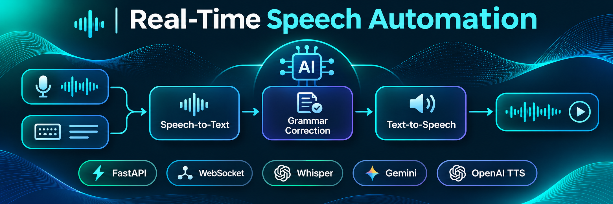
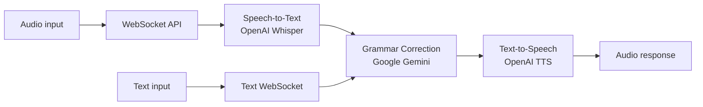

# Real-Time Speech Automation



A modular, real-time speech-processing application built with **FastAPI and WebSockets**. The primary workflow accepts audio or text from a client, transcribes speech, corrects grammar, and can return synthesized speech.

## Core workflow



## Features

- **Audio WebSocket endpoint** — receives audio bytes and processes them through transcription, grammar correction, and speech synthesis.
- **Text WebSocket endpoint** — accepts text, corrects grammar, and generates a spoken audio response.
- **Speech recognition** — uses the OpenAI Whisper transcription API (`whisper-1`).
- **Grammar correction** — uses the Google Generative AI SDK with the `gemini-1.5-flash-001` model in the supplied implementation.
- **Speech synthesis** — uses the OpenAI text-to-speech API (`tts-1`, `alloy` voice).
- **Optional audio saving** — controlled by environment settings in the controller.
- **Modular application structure** — separates routes, controllers, speech services, authentication dependency, and utility helpers.

## Technology stack

| Area | Technology |
|---|---|
| API framework | FastAPI |
| Real-time transport | WebSocket |
| Speech-to-text | OpenAI Whisper API |
| Grammar correction | Google Generative AI / Gemini |
| Text-to-speech | OpenAI TTS |
| Audio handling | SoundFile, NumPy |
| Server | Uvicorn |

## Repository structure

```text
speech-automation/
├── app/
│   ├── controllers/
│   │   └── chat_controller.py
│   ├── dependencies/
│   │   └── auth.py
│   ├── routes/
│   │   └── chat_routes.py
│   ├── schemas/
│   ├── services/
│   │   ├── grammar_correction.py
│   │   ├── speech_to_text.py
│   │   ├── text_to_speech.py
│   │   └── websocket_service.py
│   └── utils/
├── assets/
│   └── project-banner.png
├── experiments/
│   ├── notebooks/
│   ├── socketio-variant/
│   ├── http-api/
│   ├── openapi-client/
│   ├── websocket-client/
│   └── standalone-prototypes/
├── .env.example
├── .gitignore
├── main.py
└── requirements.txt
```

## Getting started

### 1. Clone the repository

```bash
git clone https://github.com/<your-username>/speech-automation.git
cd speech-automation
```

### 2. Create a virtual environment

```bash
python -m venv .venv

# Windows PowerShell
.venv\Scripts\Activate.ps1

# macOS / Linux
source .venv/bin/activate
```

### 3. Install dependencies

```bash
python -m pip install --upgrade pip
pip install -r requirements.txt
```

### 4. Configure environment variables

Create a local `.env` file using `.env.example`:

```env
OPENAI_API_KEY=your_openai_api_key
GOOGLE_API_KEY=your_google_api_key
AUDIO_SAVE_DIR=uploads
SAVE_AUDIO=false
CUSTOM_TEMP_DIR=
```

Never commit `.env` or real API credentials.

### 5. Start the server

```bash
uvicorn main:app --host 0.0.0.0 --port 8000 --reload
```

The application entry point is `main.py`. The original main implementation registers two WebSocket routes:

| Endpoint | Purpose |
|---|---|
| `/chat/audio` | Audio input → transcription → grammar correction → synthesized audio |
| `/chat/text` | Text input → grammar correction → synthesized audio |

The routes include the `websocket_auth` dependency. Review `app/dependencies/auth.py` to understand the expected authentication token/configuration before connecting a client.

## WebSocket interaction

The server sends an initial readiness message, then expects:
- Binary audio messages on `/chat/audio`.
- Text messages on `/chat/text`.

For audio processing, the server sends status/transcription/correction messages and returns generated audio bytes. See `app/controllers/chat_controller.py` for the exact message sequence and implementation details.

## Experiments

Alternative implementations and research work are organized under [`experiments/`](experiments/README.md), including:
- Speech/audio model exploration notebooks.
- Voice-cloning and TTS research notebooks.
- Socket.IO transport variant.
- Earlier HTTP, OpenAPI, and WebSocket prototypes.
- Standalone recording, transcription, and grammar-correction scripts.

These are intentionally kept separate from the primary application.

## Configuration and security notes

- API credentials must be supplied through environment variables.
- Audio saving is optional; set `SAVE_AUDIO=true` only when local retention is intended.
- Do not commit real user recordings, generated speech, transcripts, or other personal data.
- Validate file formats, payload sizes, connection limits, authentication, and retention policies before production deployment.
- Review the upstream API/model availability and SDK compatibility before running the project.

## Current status and limitations

This repository is a cleaned portfolio snapshot of the supplied implementation. The source uses synchronous SDK calls inside `async` service functions, and the runtime environment and external API credentials were not available for end-to-end validation during packaging. The dependency list may need version pinning or adjustment for your Python environment. The experimental notebooks can require additional packages and model downloads beyond the main `requirements.txt`.

## License

Add a license only after confirming that you have the right to publish the source code and included assets.
